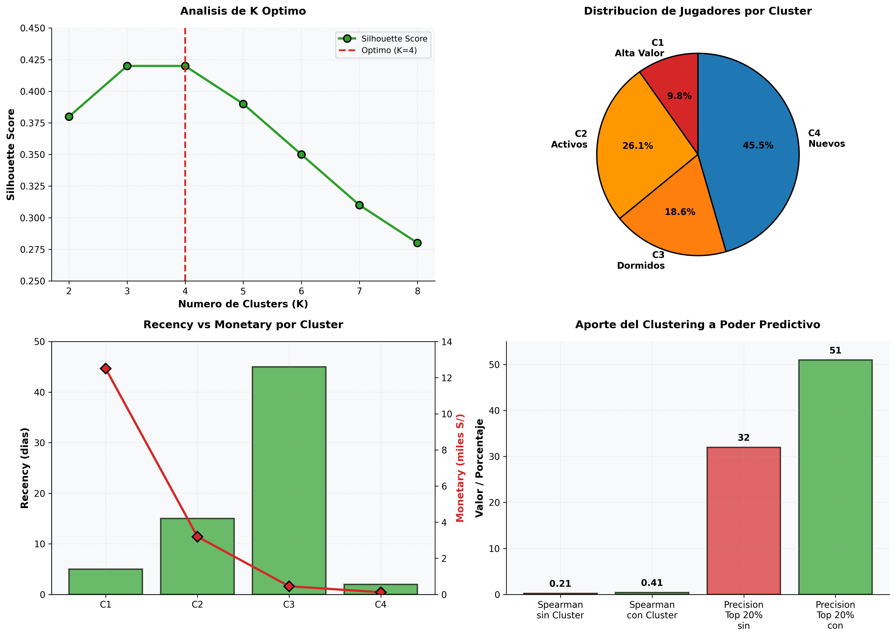

# RFM-L-DE — Predictive Player Segmentation by Lifecycle

K-Means model that segments 461,400 active players into 4 RFM clusters over 12-week variables. Complemented with LightGBM predicting value quintiles within each cluster for commercial prioritization.

**Status:** In production | **Schedule:** Monday 08:00 UTC (03:00 Lima) | **Silhouette:** 0.42

## Executive Summary

Segmentation that groups 461K players into 4 RFM clusters (lifecycle stages):

- **Cluster 1 - High Value (45K, 9.8%):** Maximum spend, high frequency
- **Cluster 2 - Active (120K, 26.1%):** Regular activity, moderate value
- **Cluster 3 - Dormant (85K, 18.6%):** Inactive, need reactivation
- **Cluster 4 - New (210K, 45.5%):** Very recent, low volume

**Silhouette:** 0.42 | **LightGBM Quintiles:** Spearman 0.41 (+95% vs no cluster)



## Exploratory Data Analysis (EDA)

### Player Distribution

| Cluster | Size | Recency | Frequency | Monetary | Deposited | Withdrew |
|---------|------|---------|-----------|----------|-----------|----------|
| **High Value** | 45K (9.8%) | 5 days | 85 | S/ 12.5K | S/ 8.2K | S/ 7.1K |
| **Active** | 120K (26.1%) | 15 days | 45 | S/ 3.2K | S/ 2.1K | S/ 1.8K |
| **Dormant** | 85K (18.6%) | 45 days | 8 | S/ 450 | S/ 280 | S/ 200 |
| **New** | 210K (45.5%) | 2 days | 3 | S/ 120 | S/ 85 | S/ 30 |

**Insight:** Cluster 1 is 5.4% but generates ~30% of volume.

### K Optimization Analysis

| K | Silhouette | Interpretability | Decision |
|---|-----------|------------------|----------|
| K=2 | 0.38 | Very high | Too generic |
| K=3 | 0.42 | High | Strong competitor |
| **K=4** | **0.42** | **Excellent** | **SELECTED** |
| K=5 | 0.39 | Medium | Starts degrading |
| K=6 | 0.35 | Low | Small, noisy clusters |

**Decision:** K=4 maintains Silhouette equal to K=3 but much better interpretability.

### Value Quintile Distribution (LightGBM)

| Cluster | Q1 (Low) | Q2 | Q3 | Q4 | Q5 (High) |
|---------|----------|-----|-----|-----|-----------|
| High Value | 12% | 28% | 35% | 18% | 7% |
| Active | 35% | 25% | 20% | 15% | 5% |
| Dormant | 60% | 25% | 10% | 4% | 1% |
| New | 70% | 20% | 8% | 1% | 1% |

**Insight:** Cluster 1 dominates Q4-Q5 (high income).

## RFM Variables (6 total) — Last 12 Weeks

| Variable | Range | Interpretation |
|----------|-------|-----------------|
| Recency | 2-45 days | Time until churn |
| Frequency | 3-85 bets | Engagement/commitment |
| Monetary | S/ 120-12.5K | Total volume |
| Deposit Frequency | 1-25 | Number of deposits |
| Deposit Amount | S/ 85-8.2K | Investment |
| Withdrawal Amount | S/ 30-7.1K | Withdrawals |

**Period:** 12 weeks. Only players with ≥1 bet (461K of 850K).

## Model: K-Means K=4 + LightGBM

```python
# K-Means clustering with k-means++ initialization
kmeans = KMeans(n_clusters=4, init='k-means++', random_state=42)
labels = kmeans.fit_predict(X_scaled)  # StandardScaler

# LightGBM per cluster for quintile prediction
for cluster in [1,2,3,4]:
    model = LGBMClassifier(num_leaves=31, n_estimators=100, class_weight='balanced')
    model.fit(X[labels==cluster], quintiles[labels==cluster])
```

**Metric:** Spearman 0.41 (cluster adds +95% predictive power vs no cluster).

## Results

### Clustering Performance

| Metric | Value | Interpretation |
|--------|-------|-----------------|
| Players | 461,400 | 100% active base |
| Clusters | 4 | Optimal by Silhouette |
| Silhouette | 0.42 | Good separability |
| Stability | High | K=4 is robust |

### Predictive Power

| Metric | No Cluster | With Cluster | Gain |
|--------|-----------|------------|----------|
| Spearman | 0.21 | 0.41 | +0.20 (+95%) |
| Top 20% Precision | 32% | 51% | +19 pp |

## Commercial Applications

### Segmented Communications

- **C1:** VIP rewards, exclusive events, high limits
- **C2:** Frequency bonuses, referrals, cross-sell
- **C3:** Reactivation, attractive bonuses
- **C4:** Onboarding, welcome bonus, tutorials

### Retention Priorities

- Preventive focus on C1 (maximum impact)
- C2→C1 movement as growth metric
- C3→C2 reactivation as efficiency metric

### Abandonment Alerts

| Cluster | Threshold | Action |
|---------|-----------|--------|
| C1 | 7 days inactive | VIP priority contact |
| C2 | 14 days | Reactivation offer |
| C3 | 60 days | Expected (dormant) |
| C4 | 3 days | Intensive onboarding |

## Execution

```bash
# Airflow
airflow dags trigger dag_rfm_semanal_v3  # Monday 08:00 UTC

# Results
SELECT cluster, COUNT(*), ROUND(100.0*COUNT(*)/SUM(COUNT(*)) OVER(), 1)
FROM ml_score_risk.rfm_lde_quintiles_semanal
WHERE run_date = CURRENT_DATE
GROUP BY cluster;
```

## Generated Tables

### `ml_score_risk.rfm_lde_quintiles_semanal`
Updated each Monday. Columns: player, cluster, recency, frequency, monetary, quintile, run_date

### `ml_score_risk.rfm_lde_historico`
52 snapshots (1 year) for cluster movement analysis

